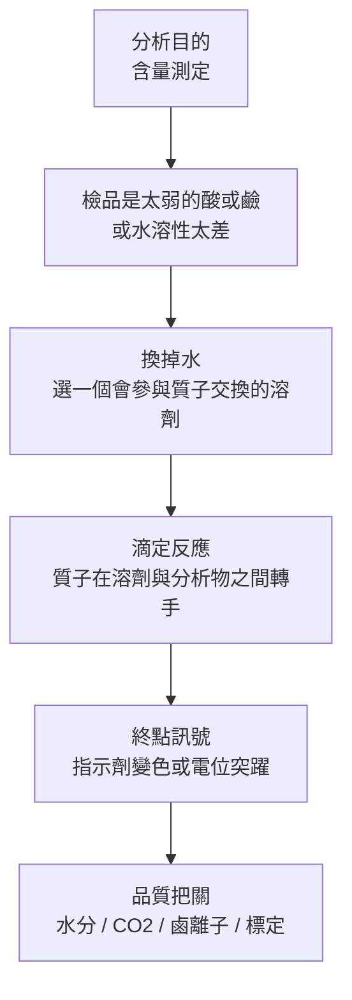

# Non-aqueous Titration｜非水滴定法

> [!summary] 一句話掌握
> 有些藥太弱，在水裡滴不出終點——因為水自己就會搶質子。把水換成一個「肯讓質子」或「肯收質子」的溶劑，藥就從弱酸弱鹼被推成可滴定的強酸強鹼。整章所有試劑、指示劑與干擾物，都是這一句話的工程配套。

> [!note] 配對檔
> 複習與考前檢索請用 [[藥物分析_非水滴定法_複習導覽卡_v1.0]]。本檔負責建立理解，導覽卡負責快速取回，兩檔的考前 60 秒逐字一致。

---

## 0. 使用方法

這一章的固定輸入密度是全書前段班：34 題來源題裡有一半以上直接考試劑名、濃度、標準品與指示劑。但如果先把「為什麼要離開水」這件事弄懂，剩下的東西會自己排成兩欄對稱的表，背起來會快很多。

第一次讀請依序往下，不要先跳去背指示劑表。複習時可直接用判讀樹、對稱總表、高混淆比較與考場壓縮。

### 最小入口檢查

| 你要先會的 | 一句話確認 |
|---|---|
| 酸鹼的質子觀點 | 酸給質子（H⁺），鹼收質子 |
| $K_a$ 與 $pK_a$ | $pK_a=-\log K_a$；$K_a$ 越小代表酸越弱，$pK_a$ 越大 |
| 共軛酸鹼對 | 鹼收了質子變成它的共軛酸；酸給出質子變成它的共軛鹼 |
| 滴定的當量點與終點 | 當量點是化學計量算出來的；終點是你實際看到的訊號 |
| 一級標準品 | 純度極高、可直接稱重定量，用來標定滴定液的物質 |

> [!note] 名詞先對齊
> 本次來源同時出現「非水滴定法」與「無水滴定法」（111-2 #1 用後者），指的是同一件事。本檔統一使用**非水滴定法 non-aqueous titration**。

---

## 1. 先看本章的分析全流程



請觀察：第三格是整章的樞紐。水在這裡不是被動的背景，而是被主動換掉的**反應參與者**——這是本章與水溶液滴定最根本的差別。

---

# 核心觀念

## 有些藥在水裡滴不出終點

### 先看一個具體情境

拿一個胺類藥物（例如 codeine）溶在水裡，用鹽酸滴定。理論上胺會接受質子，應該有當量點。實際上滴下去，pH 只是緩慢地降，沒有明顯的突躍，指示劑也慢慢地變、看不出哪一滴是終點。

換成一個很弱的酸（例如 phenobarbital）用氫氧化鈉滴定，情況一樣：曲線平緩，終點糊掉。

### 找到改變與不變

滴定的化學計量沒有問題，物質守恆也沒有問題。糊掉的是**訊號**：當量點附近的變化幅度太小。

原因是分析物太弱——弱到它與水之間的質子交換不徹底，反應沒有一口氣走完，所以當量點前後的濃度變化被抹平。

### 正式命名與門檻

來源用一個明確的數值門檻界定「太弱」：

^pa-nat-threshold

> [!note] 📌 必背 NAT01｜非水滴定法的入場條件
> **完整事實：**分析物符合下列情形時使用非水滴定法——
> ① 弱酸鹼性：$K_a$ 或 $K_b<10^{-6}$；$pK_a$ 或 $pK_b>6$（來源標為考標）
> ② 水溶性差
> ③ 反應速率慢（來源標記 $K<10^8$）、不易選擇指示劑
> ④ 終點不易觀察者
> **成立條件／比較基準：**四項是並列的入場理由，不是必須同時滿足。
> **會接到的核心判讀：**題幹給 $pK$ 數值就比 6；題幹給水溶解度（如 2.55 mg/L、0.8 µg/mL）那是第二個入場理由，不是裝飾。
> **來源：**統整本用途欄；110-1 #2、108-1 #12、107-2 #15、106-2 #10、105-2 #15。

### 成立條件與邊界

門檻是**下限不是上限**：太強的酸鹼（例如 $pK_a<4$ 的酸）在水中本來就滴得好，不需要離開水。110-1 #2 選項 A 就是把方向寫反。

還有一種完全出局的情況：**中性物質**。它既不給質子也不收質子，換什麼溶劑都沒有酸鹼反應可滴。

### 小檢查

$K_a<10^{-6}$ 與 $pK_a>6$ 是同一件事嗎？

是。取負對數會把不等號反向：$K_a<10^{-6}\Rightarrow -\log K_a>6$。兩種寫法在題目中交替出現，看到哪一種都要能立刻換到另一種。

---

## 溶劑不是背景，是搶質子的對手

### 先看水到底做了什麼

水同時會給質子也會收質子。把一個弱鹼 $B$ 放進水裡：

$$
B+\mathrm{H_2O}\rightleftharpoons B\mathrm{H^+}+\mathrm{OH^-}
$$

這個平衡只走一點點，因為水並不急著把質子交出來。等你再用酸去滴，酸給出的質子有一部分被水接走，只有剩下的才輪到 $B$。**水在跟分析物搶質子。**

來源直接給了一條同型的競爭式，說明為什麼水分是致命的：

$$
\mathrm{H_2O}+\mathrm{HClO_4}\rightleftharpoons \mathrm{H_3O^+}+\mathrm{ClO_4^-}
$$

水把過氯酸的質子先接走，變成 $\mathrm{H_3O^+}$，而 $\mathrm{H_3O^+}$ 給質子的力道比 $\mathrm{HClO_4}$ 弱得多，終點的靈敏度就被拉低。

### 找到規律

換一個**不會搶質子、甚至反過來幫忙推質子**的溶劑，同一個分析物就會表現得比在水中更強。

在冰醋酸中，過氯酸的質子沒有水可以接手，只能交給醋酸：

$$
\mathrm{HClO_4}+\mathrm{CH_3COOH}\rightleftharpoons \mathrm{CH_3COOH_2^+}+\mathrm{ClO_4^-}
$$

生成的 $\mathrm{CH_3COOH_2^+}$（醋酸的共軛酸）非常不穩定、極願意把質子丟掉，於是它就成了實際去質子化弱鹼的攻擊者。

^pa-nat-solvent-role

<svg viewBox="0 0 640 400" xmlns="http://www.w3.org/2000/svg" role="img" aria-label="質子在冰醋酸中的接力：過氯酸先把質子交給醋酸，醋酸的共軛酸再交給弱鹼藥物">
  <rect x="1" y="1" width="638" height="398" rx="14" fill="#fbfaf7" stroke="#d8d2c6" stroke-width="2"/>
  <text x="320" y="32" text-anchor="middle" font-family="system-ui,sans-serif" font-size="17" font-weight="700" fill="#25222c">冰醋酸中的質子接力（非水酸滴定）</text>
  <rect x="30" y="60" width="150" height="70" rx="10" fill="#f7e3dd" stroke="#c2452d" stroke-width="1.8"/>
  <text x="105" y="88" text-anchor="middle" font-family="system-ui,sans-serif" font-size="15" font-weight="700" fill="#8f2f1d">滴定劑</text>
  <text x="105" y="112" text-anchor="middle" font-family="system-ui,sans-serif" font-size="15" fill="#8f2f1d">HClO₄</text>
  <rect x="245" y="60" width="150" height="70" rx="10" fill="#eef1f6" stroke="#5b6b85" stroke-width="1.8"/>
  <text x="320" y="88" text-anchor="middle" font-family="system-ui,sans-serif" font-size="15" font-weight="700" fill="#3a4557">溶劑</text>
  <text x="320" y="112" text-anchor="middle" font-family="system-ui,sans-serif" font-size="15" fill="#3a4557">CH₃COOH</text>
  <rect x="460" y="60" width="150" height="70" rx="10" fill="#e6f0ea" stroke="#2f6b4f" stroke-width="1.8"/>
  <text x="535" y="88" text-anchor="middle" font-family="system-ui,sans-serif" font-size="15" font-weight="700" fill="#1f5039">分析物</text>
  <text x="535" y="112" text-anchor="middle" font-family="system-ui,sans-serif" font-size="15" fill="#1f5039">弱鹼藥物 B</text>
  <line x1="182" y1="95" x2="240" y2="95" stroke="#25222c" stroke-width="2.6"/>
  <polygon points="243,95 231,89 231,101" fill="#25222c"/>
  <text x="211" y="82" text-anchor="middle" font-family="system-ui,sans-serif" font-size="13" font-weight="700" fill="#25222c">H⁺</text>
  <line x1="397" y1="95" x2="455" y2="95" stroke="#25222c" stroke-width="2.6"/>
  <polygon points="458,95 446,89 446,101" fill="#25222c"/>
  <text x="426" y="82" text-anchor="middle" font-family="system-ui,sans-serif" font-size="13" font-weight="700" fill="#25222c">H⁺</text>
  <text x="320" y="185" text-anchor="middle" font-family="system-ui,sans-serif" font-size="14.5" fill="#1f2930">第一步　HClO₄ ＋ CH₃COOH ⇌ CH₃COOH₂⁺ ＋ ClO₄⁻</text>
  <text x="320" y="212" text-anchor="middle" font-family="system-ui,sans-serif" font-size="14.5" fill="#1f2930">第二步　CH₃COOH₂⁺ ＋ B → BH⁺ ＋ CH₃COOH</text>
  <line x1="60" y1="240" x2="580" y2="240" stroke="#d8d2c6" stroke-width="1.6"/>
  <text x="320" y="272" text-anchor="middle" font-family="system-ui,sans-serif" font-size="15" font-weight="700" fill="#c2452d">若混入水，接力就被攔截：</text>
  <text x="320" y="300" text-anchor="middle" font-family="system-ui,sans-serif" font-size="14.5" fill="#8f2f1d">H₂O ＋ HClO₄ ⇌ H₃O⁺ ＋ ClO₄⁻</text>
  <text x="320" y="326" text-anchor="middle" font-family="system-ui,sans-serif" font-size="13.5" fill="#5b5b5b">H₃O⁺ 給質子的力道遠不如 CH₃COOH₂⁺</text>
  <text x="320" y="350" text-anchor="middle" font-family="system-ui,sans-serif" font-size="13.5" fill="#5b5b5b">→ 終點靈敏度下降，所以水分必須壓到極低</text>
  <text x="320" y="382" text-anchor="middle" font-family="system-ui,sans-serif" font-size="13" fill="#5b5b5b">請觀察：溶劑是接力的中繼站，不是旁觀者</text>
</svg>

### 成立條件與邊界

- 這條接力只在**溶劑本身能接受質子**時成立。若溶劑完全不收質子（後面會遇到），就沒有中繼站。
- 反過來要滴弱酸時，需要的是一個**肯接質子**的鹼性溶劑，把弱酸的質子拉走。方向相反，邏輯相同。
- $\mathrm{CH_3COOH_2^+}$ 這個物種在來源的 106-1 反應圖中直接出現（$2\mathrm{CH_3COOH_2^+}+2\mathrm{CH_3COO^-}\rightarrow 4\mathrm{CH_3COOH}$），不是外加的假設。

### 小檢查

為什麼「非水」不只是「不含水」，而是「換一個會參與反應的溶劑」？

因為若只是把水抽掉而換上完全不參與的液體，質子沒有中繼站，滴定劑的酸性也推不上去。真正起作用的是溶劑的酸鹼身分。

---

## 把溶劑依「能不能給、能不能收質子」分成四類

### 先建立分類軸

上一節得到兩個獨立的能力：**給質子的能力**與**接受質子的能力**。以水為比較基準，把兩個能力當成兩根軸，四類溶劑就自然落在四個位置。

<svg viewBox="0 0 640 460" xmlns="http://www.w3.org/2000/svg" role="img" aria-label="以水為基準的溶劑分類：橫軸為供給質子能力，縱軸為接受質子能力，四類溶劑各佔一區">
  <rect x="1" y="1" width="638" height="458" rx="14" fill="#fbfaf7" stroke="#d8d2c6" stroke-width="2"/>
  <text x="320" y="30" text-anchor="middle" font-family="system-ui,sans-serif" font-size="17" font-weight="700" fill="#25222c">四類溶劑：以水為原點的兩根能力軸</text>
  <line x1="90" y1="390" x2="590" y2="390" stroke="#25222c" stroke-width="2.2"/>
  <polygon points="596,390 582,384 582,396" fill="#25222c"/>
  <line x1="90" y1="390" x2="90" y2="60" stroke="#25222c" stroke-width="2.2"/>
  <polygon points="90,54 84,68 96,68" fill="#25222c"/>
  <text x="440" y="416" font-family="system-ui,sans-serif" font-size="13.5" font-weight="600" fill="#25222c">供給質子能力（酸性）→</text>
  <text x="100" y="72" font-family="system-ui,sans-serif" font-size="13.5" font-weight="600" fill="#25222c">↑ 接受質子能力（鹼性）</text>
  <circle cx="300" cy="250" r="7" fill="#25222c"/>
  <text x="312" y="246" font-family="system-ui,sans-serif" font-size="14" font-weight="700" fill="#25222c">水 H₂O（比較基準）</text>
  <line x1="90" y1="250" x2="590" y2="250" stroke="#a8a8a8" stroke-width="1.2" stroke-dasharray="6 5"/>
  <line x1="300" y1="60" x2="300" y2="390" stroke="#a8a8a8" stroke-width="1.2" stroke-dasharray="6 5"/>
  <rect x="400" y="268" width="175" height="88" rx="10" fill="#f7e3dd" stroke="#c2452d" stroke-width="1.6"/>
  <text x="487" y="292" text-anchor="middle" font-family="system-ui,sans-serif" font-size="14" font-weight="700" fill="#8f2f1d">酸性溶劑</text>
  <text x="487" y="312" text-anchor="middle" font-family="system-ui,sans-serif" font-size="12.5" fill="#8f2f1d">Protogenic</text>
  <text x="487" y="332" text-anchor="middle" font-family="system-ui,sans-serif" font-size="12.5" fill="#8f2f1d">酸性比水強</text>
  <text x="487" y="350" text-anchor="middle" font-family="system-ui,sans-serif" font-size="12.5" fill="#8f2f1d">→ 滴極弱鹼</text>
  <rect x="118" y="92" width="175" height="88" rx="10" fill="#e6f0ea" stroke="#2f6b4f" stroke-width="1.6"/>
  <text x="205" y="116" text-anchor="middle" font-family="system-ui,sans-serif" font-size="14" font-weight="700" fill="#1f5039">鹼性溶劑</text>
  <text x="205" y="136" text-anchor="middle" font-family="system-ui,sans-serif" font-size="12.5" fill="#1f5039">Protophyllic</text>
  <text x="205" y="156" text-anchor="middle" font-family="system-ui,sans-serif" font-size="12.5" fill="#1f5039">鹼性比水強、酸性比水弱</text>
  <text x="205" y="174" text-anchor="middle" font-family="system-ui,sans-serif" font-size="12.5" fill="#1f5039">→ 滴弱酸</text>
  <rect x="182" y="268" width="175" height="70" rx="10" fill="#eef1f6" stroke="#5b6b85" stroke-width="1.6"/>
  <text x="269" y="292" text-anchor="middle" font-family="system-ui,sans-serif" font-size="14" font-weight="700" fill="#3a4557">兩性溶劑</text>
  <text x="269" y="311" text-anchor="middle" font-family="system-ui,sans-serif" font-size="12.5" fill="#3a4557">Amphiprotic</text>
  <text x="269" y="330" text-anchor="middle" font-family="system-ui,sans-serif" font-size="12.5" fill="#3a4557">兩邊都比水弱</text>
  <rect x="105" y="330" width="140" height="52" rx="10" fill="#efeee9" stroke="#8a8a8a" stroke-width="1.6" stroke-dasharray="5 4"/>
  <text x="175" y="352" text-anchor="middle" font-family="system-ui,sans-serif" font-size="14" font-weight="700" fill="#4a4a4a">無質子溶劑</text>
  <text x="175" y="371" text-anchor="middle" font-family="system-ui,sans-serif" font-size="12.5" fill="#4a4a4a">Aprotic：兩邊都沒有</text>
  <text x="320" y="440" text-anchor="middle" font-family="system-ui,sans-serif" font-size="13" fill="#5b5b5b">請觀察：滴弱鹼往右走、滴弱酸往上走；左下角那一類不參與質子交換</text>
</svg>

### 四類溶劑的固定名單

^pa-nat-solvent-class

> [!note] 📌 必背 NAT02｜酸性溶劑 Protogenic solvent（質子性溶劑）
> **完整事實：**酸性比水強、供給質子能力很強，適於**極弱鹼**之滴定（即非水酸滴定）。成員：formic acid、**acetic acid**、acetic anhydride、propionic acid、sulfonyl chloride。
> **成立條件／比較基準：**以水為基準比較酸性。
> **會接到的核心判讀：**冰醋酸與醋酐屬此類，所以它們**不能**拿來做非水鹼滴定（105-2 #2）。
> **來源：**統整本溶劑欄。

> [!note] 📌 必背 NAT03｜無質子溶劑 Aprotic solvent（中性溶劑）
> **完整事實：**呈中性、無法供給或接受質子、誘電率低、偶極矩小、反應慢，常和其他溶劑混合使用。成員：benzene、**dioxane**、ethyl acetate、CCl₄、cyclohexane、CHCl₃、acetone、acetonitrile、methylenechloride。
> **成立條件／比較基準：**不參與質子交換，只當稀釋與溶解介質。
> **會接到的核心判讀：**111-1 #4 選項 C「滴定劑之配製可使用無質子溶劑」為正確；dioxane 可取代冰醋酸但有附加條件（見 NAT07）。
> **來源：**統整本溶劑欄；111-1 #4。

> [!note] 📌 必背 NAT04｜兩性溶劑 Amphiprotic solvent
> **完整事實：**酸與鹼性**都比水弱**，具**質子自遞作用 autoprotolysis**，用於分析較弱酸或鹼性藥物。成員：methanol、ethanol、ethyleneglycol、2-propanol、glycerin、benzylalcohol。
> **成立條件／比較基準：**同時具備給與收質子的能力，但兩邊都不強。
> **會接到的核心判讀:**甲醇屬此類，這是甲醇鈉能以甲醇為介質配製的背景。
> **來源：**統整本溶劑欄。

> [!note] 📌 必背 NAT05｜鹼性溶劑 Protophyllic solvent
> **完整事實：**鹼性比水強、酸性比水弱。分兩級——
> **強鹼溶劑：**n-butylamine、ethylenediamine、morpholine
> **弱鹼溶劑：**dimethylformamide（DMF）、pyridine
> **成立條件／比較基準：**以水為基準比較鹼性。
> **會接到的核心判讀：**這一類是非水鹼滴定（分析弱酸）的溶劑池；112-2 #1 選 pyridine 即出自此表。
> **來源：**統整本溶劑欄；112-2 #1、105-2 #2。

### 成立條件與邊界

- 兩性溶劑的「兩性」指的是**同時具備兩種能力**，不是「強度介於中間」。它兩邊都比水弱。
- 無質子溶劑常與其他溶劑混用，因為它自己撐不起質子交換。
- 同一個化合物在不同章節可能扮演不同角色：DMF 在本章是弱鹼溶劑，在層析章是移動相或稀釋劑。角色由本次步驟決定。

### 小檢查

為什麼乙酐（acetic anhydride）不能用於非水鹼滴定？

它屬酸性溶劑（NAT02）。鹼滴定需要一個肯接質子的鹼性溶劑，酸性溶劑會反過來搶走鹼的位置。105-2 #2 就是考這一刀。

---

## 分析弱鹼：非水酸滴定的滴定劑與溶劑

### 帶入已知

上一節確定：要滴極弱鹼，需要一個很會給質子的體系。這一節把它做成具體的試劑組合。

^pa-nat-acid-titrant

> [!note] 📌 必背 NAT06｜非水酸滴定的滴定劑
> **完整事實：**非水滴定法最常用的酸滴定液為 **HClO₄ 過氯酸**；配製濃度 **70.0–72.0%**，目的是**防止自發性爆炸分解**。
> **成立條件／比較基準：**98% 或 90% 過氯酸有爆炸危險，不可使用。
> **會接到的核心判讀：**題目問「配 0.1 N 過氯酸用什麼」答 70% 過氯酸水溶液；問「不需要下列何者」答 90% 過氯酸。
> **來源：**統整本滴定劑欄；108-2 #14、110-2 #6、109-1 #14、104-1 #8。

> [!note] 📌 必背 NAT07｜非水酸滴定的溶劑與加料順序
> **完整事實：**過氯酸溶於酸性溶液**冰醋酸（＝乙酸 CH₃COOH）**，再加**醋酐（乙酐）吸水**，此步驟為**放熱反應**。
> 過氯酸**未經冰醋酸稀釋不可直接加入醋酸酐**。
> 若用中性溶液**二氧六圜 dioxane** 取代冰醋酸，則需**先用活化鋁處理**。
> **成立條件／比較基準：**醋酐的角色是除去過氯酸與冰醋酸中的水分，不是溶劑。
> **會接到的核心判讀：**113-2 #5 問「強酸滴定液最常與何者搭配」答乙酸；107-2 #18 問溶劑答冰醋酸。
> **來源：**統整本滴定劑與溶劑欄；104-1 #8、113-1 #5、107-2 #18、113-2 #5。

### 三個角色不能互換

| 試劑 | 在非水酸滴定中的角色 | 一句話功能 |
|---|---|---|
| 冰醋酸（乙酸） | 溶劑 | 當質子中繼站，把過氯酸推成更強的質子供給者 |
| 醋酐（乙酐） | 除水劑 | 吸掉過氯酸與冰醋酸中的水分，放熱 |
| 乙酸汞 | 除鹵劑 | 把分析物帶來的氯、溴沉澱掉（見干擾節） |

三者名字都有「乙酸」或「醋」，但功能完全不同。這是本章最容易被互換的三個名詞。

### 小檢查

醋酐是溶劑還是除水劑？

除水劑。溶劑是冰醋酸。把醋酐當溶劑會直接答錯 104-1 #8 與 113-1 #5。

---

## 標定過氯酸：KHP 的雙重身分

### 先看一個看起來矛盾的事實

過氯酸的一級標準品是**鄰苯二甲酸氫鉀 potassium biphthalate（KHP）**，化學式 $\mathrm{C_6H_4(CO_2K)CO_2H}$。

矛盾在哪？KHP 在水中被教成**弱酸**（它還留著一個 $-\mathrm{COOH}$）。為什麼可以拿一個酸去標定另一個酸？

### 找到規律

因為酸鹼身分是**相對的**。KHP 的另一半 $-\mathrm{COO^-K^+}$ 是羧酸的共軛鹼根。在冰醋酸這種酸性環境中，面對比它強得多的過氯酸體系，KHP 唯一能做的事就是**接受質子**——它在這裡是鹼。

$$
\mathrm{C_6H_4(CO_2K)CO_2H}+\mathrm{HClO_4}\longrightarrow \mathrm{C_6H_4(CO_2H)_2}+\mathrm{KClO_4}
$$

^pa-nat-khp

這正是本章最核心的第一性原理在標準品身上的重演：**角色由環境決定，不由名字決定。**

> [!note] 📌 必背 NAT08｜非水酸滴定的一級標準品
> **完整事實：**標定過氯酸用**鄰苯二甲酸氫鉀 KHP＝potassium biphthalate＝$\mathrm{C_6H_4(CO_2K)CO_2H}$**；在非水酸滴定實驗中它扮演**一級標準鹼**。
> **成立條件／比較基準：**是 **potassium**（鉀）不是 **sodium**（鈉）。
> **會接到的核心判讀：**109-2 #5 直接問身分（一級標準鹼）；104-1 #8 用 sodium biphthalate 當陷阱；108-1 #14 用化學式出題。
> **來源：**統整本滴定劑欄；109-2 #5、108-1 #14、104-1 #8、109-1 #14。

### 成立條件與邊界

- KHP 是**過氯酸**的標準品。它**不是**甲醇鈉的標準品——這是 114-1 #4 的答案來源。
- 「一級標準鹼」的說法只在非水酸滴定的情境成立；在水溶液酸鹼滴定中 KHP 常被當作標準酸使用。看到 KHP 先問：這一題的滴定液是酸還是鹼？

### 小檢查

為什麼同一個 KHP 在不同題目裡一下是酸、一下是鹼？

因為它有兩個官能基，且酸鹼身分取決於對手。對上比它更強的酸，它露出共軛鹼根；對上鹼，它露出未解離的羧酸。

---

## 分析弱酸：非水鹼滴定的滴定劑

### 帶入已知

要滴弱酸，需要一個很會**接受質子**的體系。來源指定的滴定劑是甲醇鈉。

^pa-nat-base-titrant

> [!note] 📌 必背 NAT09｜甲醇鈉的身分與製備
> **完整事實：**非水滴定法最常用的鹼是 **CH₃ONa 甲醇鈉**。製備方式為**金屬鈉溶於甲醇 → 放熱反應 → 冰塊冷卻 → 以苯 benzene 稀釋**；若形成膠體可改用**甲醇鋰 lithium methoxide**。
> **成立條件／比較基準：**甲醇鈉**不是**氫氧化鈉的甲醇溶液。
> **會接到的核心判讀：**113-1 #3 選項 A 就是用「氫氧化鈉之甲醇溶液」當錯誤敘述；111-1 #4 選項 B 用 lithium methoxide 的甲醇溶液當正確敘述。
> **來源：**統整本滴定劑欄；106-1 #14、113-1 #3、111-1 #4、114-1 #4。

> [!note] 📌 必背 NAT10｜甲醇鈉的貯存
> **完整事實：**應**避免水分和 CO₂**，否則會干擾甲醇鈉**呈白色混濁**：
> $$\mathrm{H_2O}+\mathrm{CO_2}+\mathrm{CH_3ONa}\longrightarrow \mathrm{CH_3OH}+\mathrm{Na_2CO_3}$$
> **成立條件／比較基準：**混濁來自生成的碳酸鈉。
> **會接到的核心判讀：**113-1 #3 選項 C、114-1 #4 選項 B 都以此為正確敘述。
> **來源：**統整本滴定劑欄；113-1 #3、114-1 #4。

> [!note] 📌 必背 NAT11｜非水鹼滴定的標定組合
> **完整事實：**甲醇鈉的**一級標準品為 benzoic acid 苯甲酸**（置於燒瓶）；**指示劑為 thymol blue 瑞香酚藍**；**溶劑為 DMF**。
> **成立條件／比較基準：**這是一組三件式，題目常只換其中一件。
> **會接到的核心判讀：**114-1 #4 用 KHP 替換苯甲酸當錯誤選項；113-1 #3 選項 D「可用苯甲酸測定其力價」為正確。
> **來源：**114-1 #4 解析；113-1 #3。

### 成立條件與邊界

- 苯稀釋的「苯 benzene」與標定用的「苯甲酸 benzoic acid」是兩種不同物質，出現位置也不同（製備 vs 標定）。
- 甲醇鈉的兩個弱點（水、CO₂）跟過氯酸的弱點（水）不完全一樣：過氯酸只怕水，甲醇鈉水和 CO₂ 都怕。

### 小檢查

lithium methoxide 在本章出現兩次，身分一樣嗎？

不一樣。在 111-1 #4 與統整本中它是**滴定劑的替代品**（甲醇鈉成膠時改用）；在 105-2 #15 中它是**被分析的檢品**（pKa 15.2，適用非水滴定）。角色由題幹決定。

---

## 弱酸有多弱，決定溶劑要多鹼

### 先看一個具體對比

同樣是要滴的弱酸，有的很弱、有的稍強。若一律用最強的鹼性溶劑，稍強的那一支會連同基質中其他酸性成分一起被滴掉，失去選擇性。

### 找到規律與正式化

^pa-nat-base-solvent

> [!note] 📌 必背 NAT12｜非水鹼滴定的溶劑分級
> **完整事實：**
> **弱酸性藥物** → 用**強鹼溶劑**：n-butylamine、ethylenediamine、morpholine
> **酸性稍強藥物** → 用**弱鹼溶劑**：DMF 或 pyridine
> DMF **會跟 methoxide 反應，需做空白實驗**。
> **成立條件／比較基準：**藥物越弱，溶劑要越鹼，才推得動。
> **會接到的核心判讀：**這一條與指示劑配對（NAT13）合起來就是 104-2 #2 的答案。
> **來源：**統整本分析欄；113-1 #3 解析表；112-2 #1、105-2 #2、104-2 #2。

### 為什麼分級就等於選擇性

強鹼溶劑推得動所有弱酸 → 得到**總量**。
弱鹼溶劑只推得動酸性較強的那一支 → 得到**選擇性單一成分**。

兩者相減就得到剩下那一支。這正是 104-2 #2 與統整本應用欄的差量分析法（後面紙筆計算會完整示範）。

### 小檢查

DMF 為什麼要做空白實驗？

因為 DMF 本身會跟 methoxide 反應而消耗滴定劑；空白實驗把這一份扣掉，才不會高估檢品含量。

---

## 終點怎麼看見：兩組指示劑與電位滴定

### 先把名字的方向釘死

這是全章最大的陷阱，先講清楚再看名單：

> [!warning] 名字看的是滴定劑，不是分析物
> **非水「酸」滴定**＝用**酸**（過氯酸）當滴定液 → 分析的是**弱鹼**藥物。
> **非水「鹼」滴定**＝用**鹼**（甲醇鈉）當滴定液 → 分析的是**弱酸**藥物。
> 來源題目兩種問法都用過：「用於弱酸的非水滴定分析」與「不適合用於非水酸滴定分析」指的是**同一組**指示劑。看到題目先把它翻譯成「滴定劑是誰」。

^pa-nat-indicator

> [!note] 📌 必背 NAT13｜兩組指示劑
> **完整事實：**
> **非水酸滴定（用來分析弱鹼）：**結晶紫 crystal violet、孔雀石綠 malachite green、喹吶啶紅 quinaldine red
> **非水鹼滴定（用來分析弱酸）：**瑞香酚藍 thymol blue、偶氮紫 azo violet、對羥偶氮苯 p-hydroxyazobenzene
> **溶劑配對：**強鹼溶劑（n-butylamine 等）配 **azo violet**；弱鹼溶劑（DMF）配 **thymol blue**。
> **成立條件／比較基準：**p-hydroxyazobenzene 只出現在 114-1 解析，統整本未列（見來源邊界）。
> **會接到的核心判讀：**這張表在本次來源中出現 6 次，是全章複製率最高的考點。
> **來源：**統整本指示劑欄；114-1 #3、113-2 #4、110-2 #3、109-2 #3、108-2 #15、106-2 #13、104-2 #2。

> [!note] 📌 必背 NAT14｜結晶紫的變色
> **完整事實：**crystal violet 結晶紫的變色為**藍 → 綠**，來源標示 pH 值範圍 **2.0～0.5**。
> **成立條件／比較基準：**用於非水酸滴定的終點判讀。
> **會接到的核心判讀：**113-1 #5 選項 D 以「結晶紫為此類滴定的常用指示劑」為正確敘述。
> **來源：**統整本指示劑欄；113-1 #5 解析。

### 指示劑不是唯一選擇

來源在「反應當量點」欄直接指定：終點也可以用**電位滴定法 potentiometric titration** 判定。理由不需要背——滴定接近當量點時電位會急劇變化，這件事不因溶劑換成非水而消失。

所以 111-1 #4 選項 A「無法以電位滴定法進行終點檢測」是錯的。

### 成立條件與邊界

- 鐵明礬 ferric ammonium sulfate 不屬於本章指示劑（109-2 #3），它是沉澱滴定 Volhard 法的指示劑。
- 酚酞 phenolphthalein、甲基紅 methyl red 是水溶液酸鹼滴定的指示劑，在 108-2 #15 中當干擾選項。

### 小檢查

「不適合用於弱鹼的非水滴定分析」的指示劑是哪一組？

弱鹼 → 非水**酸**滴定 → 不適合的是**鹼滴定側**那組：thymol blue、azo violet。106-2 #13 答案就是 thymol blue。

---

## 三種會毀掉結果的干擾：水、CO₂、鹵離子

### 帶入已知

前面已經看過水為什麼有害（它會攔截質子）。這一節把三種干擾與各自的對策收在一起。

^pa-nat-interference

> [!note] 📌 必背 NAT15｜水分限量與環境條件
> **完整事實：****水分必須低於 0.05%**。原因：
> $$\mathrm{H_2O}+\mathrm{HClO_4}\rightleftharpoons \mathrm{H_3O^+}+\mathrm{ClO_4^-}$$
> 生成的 $\mathrm{H_3O^+}$ 會**降低滴定終點的靈敏度**。
> 另外，**溫度、濕度需與標定標準溶液時一致**。
> **成立條件／比較基準：**這是非水滴定之所以叫「非水」的操作底線。
> **會接到的核心判讀：**溶劑選項出現純水、藥用酒精（含水）時直接排除（107-2 #18）。
> **來源：**統整本標準欄。

> [!note] 📌 必背 NAT16｜鹵離子干擾與乙酸汞
> **完整事實：**分析物以**鹽酸鹽或溴酸鹽**存在時（如鹽酸嗎啡、neostigmine bromide），滴定前**須先加乙酸汞 mercuric acetate**，把氯或溴**沉澱**掉以避免影響反應：
> $$\mathrm{Hg(CH_3COO)_2}+2\mathrm{Cl^-}\longrightarrow \mathrm{HgCl_2}+2\mathrm{CH_3COO^-}$$
> **成立條件／比較基準：**針對相對離子 counter ion，不是針對藥物本身。
> **會接到的核心判讀：**題幹只要出現 hydrochloride、bromide 字樣就要想到它。
> **來源：**統整本分析藥品欄；110-1 #1、113-1 #5、106-1 #11。

### 為什麼鹵離子非除不可

鹽酸鹽解離出的 $\mathrm{Cl^-}$ 在冰醋酸中是一個**會競爭質子**的鹼。它會分走 $\mathrm{CH_3COOH_2^+}$，使實際滴定的當量數不等於藥物的當量數。加乙酸汞把 $\mathrm{Cl^-}$ 變成幾乎不解離的 $\mathrm{HgCl_2}$，這條競爭路徑就被關掉。

CO₂ 的干擾只發生在**鹼**滴定側（甲醇鈉），因為 CO₂ 是酸性氣體，會消耗鹼並生成碳酸鈉沉澱。

### 三種干擾對照

| 干擾物 | 主要傷害哪一側 | 對策 | 觀察到的異常 |
|---|---|---|---|
| 水 | 兩側都傷，酸側最明顯 | 水分 <0.05%、加醋酐 | 終點靈敏度下降 |
| CO₂ | 非水鹼滴定 | 密封貯存甲醇鈉 | 白色混濁 |
| Cl⁻ / Br⁻ | 非水酸滴定 | 加乙酸汞 | 當量數偏高、終點不準 |

### 小檢查

題目說檢品是 morphine hydrochloride，你要先做什麼？

先加乙酸汞除氯，再用過氯酸做非水酸滴定。

---

## 哪些藥走哪一邊

### 帶入已知

到這裡兩套工具都齊了。最後一塊積木是把藥物分派到正確的那一邊。

^pa-nat-drugs

> [!note] 📌 必背 NAT17｜適用藥物清單
> **非水酸滴定（分析弱鹼藥物）：**
> ① 含 **Amine** 藥品：adrenaline、chlorpromazine、phenylephrine、cocaine、morphine、codeine、diazepam
> ② **有機鈉鹽**：如 sodium benzoate
> ③ **鹽酸鹽、溴酸鹽**（須先加乙酸汞）
> **非水鹼滴定（分析弱酸藥物）：**secobarbital、sulfisoxazole、phenytoin、dicumarol、hydrochlorothiazide
> **會接到的核心判讀：**題目給藥名要先判酸鹼性再選邊；中性物質兩邊都不適用。
> **來源：**統整本分析藥品欄；111-2 #1、111-2 #2、103-2 #5、109-1 #13。

### 怎麼在考場快速判酸鹼性

不用背整張清單，用結構線索：

| 看到什麼 | 判為 | 走哪一邊 |
|---|---|---|
| 環上或側鏈有 N（生物鹼、amine） | 弱鹼 | 非水酸滴定 |
| 藥名結尾 sodium 或 -ate 的鈉鹽 | 弱鹼（羧酸的共軛鹼） | 非水酸滴定 |
| 藥名有 hydrochloride、bromide | 弱鹼的鹽 | 非水酸滴定＋乙酸汞 |
| barbital、sulfa-、-toin、酚性 OH | 弱酸 | 非水鹼滴定 |
| 類固醇骨架、無明顯可解離基 | 中性 | 兩邊都不適用 |

### 兩個必踩的陷阱

- **sodium benzoate 是鹼，不是酸。**苯甲酸是酸，它的鈉鹽是共軛鹼（111-2 #2 選項 D）。
- **acetaminophen 是弱酸。**它有酚性 OH，走鹼滴定側；111-2 #2 的答案就是它。

### 小檢查

prednisolone 為什麼兩邊都不能用？

它是類固醇、屬中性物質，沒有可供滴定的酸鹼基。111-2 #1 的答案。

---

# 試劑與角色卡

## 滴定劑對照卡

^pa-nat-cards

| 面向 | 非水酸滴定 | 非水鹼滴定 |
|---|---|---|
| 滴定劑 | HClO₄ 過氯酸 | CH₃ONa 甲醇鈉 |
| 濃度／製法 | 70.0–72.0% | 金屬鈉溶於甲醇→冰塊冷卻→苯稀釋 |
| 替代品 | 無（來源未列） | lithium methoxide 甲醇鋰（成膠時） |
| 溶劑 | 冰醋酸（＋醋酐吸水） | 強鹼溶劑或弱鹼溶劑 |
| 一級標準品 | KHP＝potassium biphthalate | benzoic acid 苯甲酸 |
| 標定用指示劑 | crystal violet | thymol blue |
| 標定用溶劑 | 冰醋酸 | DMF |
| 分析對象 | 弱鹼藥物 | 弱酸藥物 |
| 主要怕什麼 | 水、鹵離子 | 水、CO₂ |

這張表是全章的骨架。左右兩欄逐格對稱，凡是題目換掉其中一格，答案就在同一列的另一格裡。

## 分析角色卡

| 角色 | 本章由誰擔任 | 一句話功能 |
|---|---|---|
| Analyte 分析物 | 弱鹼藥物或弱酸藥物 | 要被定量的對象 |
| Titrant 滴定劑 | HClO₄ 或 CH₃ONa | 提供或接受質子 |
| Solvent 溶劑 | 冰醋酸／DMF／n-butylamine 等 | 質子中繼站，推高表觀酸鹼強度 |
| Primary standard 一級標準品 | KHP 或 benzoic acid | 標定滴定液的真實力價 |
| Masking reagent 遮蔽試劑 | 乙酸汞 | 沉澱干擾的鹵離子 |
| Drying reagent 除水劑 | 醋酐（乙酐） | 吸掉體系中的水 |
| Diluent 稀釋劑 | benzene、dioxane 等無質子溶劑 | 只溶解不參與反應 |
| Indicator 指示劑 | crystal violet 或 thymol blue 等 | 把終點變成顏色 |
| Blank 空白 | DMF 系統的空白試驗 | 扣掉 DMF 與 methoxide 反應消耗的滴定劑 |

---

# 把全章壓成一棵判讀樹

^pa-nat-tree

```text
題目給了什麼
├─ 給 pK 值 → 比 6：pKa 或 pKb > 6 才進場；pKa < 4 是誘餌
│   └─ 另附水溶解度極低 → 也是入場理由
├─ 給藥名 → 先判酸鹼性
│   ├─ 含 N／鈉鹽／鹽酸鹽 → 弱鹼 → 非水酸滴定（HClO₄）
│   ├─ barbital／sulfa-／酚 OH → 弱酸 → 非水鹼滴定（CH₃ONa）
│   └─ 類固醇等中性 → 兩邊皆不適用
├─ 問滴定劑 → 酸側 70% HClO₄；鹼側 CH₃ONa（成膠改 lithium methoxide）
├─ 問溶劑 → 酸側冰醋酸（醋酐吸水；dioxane 需活化鋁）
│           鹼側：藥很弱用強鹼溶劑，藥稍強用弱鹼溶劑 DMF/pyridine
├─ 問一級標準品 → 酸側 KHP（potassium 不是 sodium）；鹼側 benzoic acid
├─ 問指示劑 → 酸側 crystal violet／malachite green／quinaldine red
│             鹼側 thymol blue／azo violet／p-hydroxyazobenzene
├─ 問干擾 → 水（<0.05%）／CO₂（鹼側白濁）／Cl⁻ Br⁻（加乙酸汞）
├─ 問終點 → 指示劑或電位滴定法皆可
└─ 問混合物選擇性 → 弱鹼溶劑測單一成分，強鹼溶劑測總量，相減得另一成分
```

## 符號與單位總表

| 符號 | 意義 | 單位 | 常見混淆 |
|---|---|---|---|
| $K_a$ | 酸解離常數 | 無單位（本章比較用） | 與 $K_b$ 對象弄反 |
| $K_b$ | 鹼解離常數 | 無單位（本章比較用） | 與 $K_a$ 對象弄反 |
| $pK_a$ | $-\log K_a$ | 無單位 | 門檻是 >6 不是 <4 |
| $pK_b$ | $-\log K_b$ | 無單位 | 胺類藥物題幹給的常是共軛酸的 $pK_a$ |
| $N$ | 當量濃度 normality | eq/L（本章滴定液皆 0.1 N） | 與 molarity 混稱 |
| % | 過氯酸配製濃度 | w/w 百分比 | 70–72% 與 90%、98% 混淆 |
| $V$ | 滴定液用量 | mL | 差量法中兩次用量不可對調 |

---

# 紙筆計算

^pa-nat-calc

> [!note] 本章來源題目狀況
> **本次來源的 34 題全部為敘述與配對判斷題，沒有需要代入數值求解的計算題。**下方第一項為題目實際會用到的紙筆判讀；第二項為統整本應用欄與 104-2 #2 所描述的差量法結構，數值為**自編教學例**，不是國考真題。

## 紙筆判讀一｜pK 門檻的兩種寫法互換

**題目真正問：**這個藥的酸鹼強度夠不夠弱，值得離開水。

**母式：**

$$
pK=-\log K
$$

**兩種寫法等價：**

$$
K<10^{-6}
\quad\Longleftrightarrow\quad
pK>6
$$

取負對數會把不等號反向，這是本章唯一需要注意方向的代數動作。

**把來源四題一次掃過：**

| 來源 | 題幹給的 $pK$ | 與 6 比較 | 判定 |
|---|---|---|---|
| 108-1 #12 chlorpromazine | 9.3 | $9.3>6$ | 適用非水滴定 |
| 107-2 #15 chlorhexidine | 10.8 | $10.8>6$ | 適用非水滴定 |
| 106-2 #10 chlorhexidine acetate | 10.8 | $10.8>6$ | 適用非水滴定 |
| 105-2 #15 lithium methoxide | 15.2 | $15.2>6$ | 適用非水滴定 |

**檢查：**四題方向一致，且題幹都另附極差的水溶解度（2.55 mg/L、0.8 µg/mL 等），兩個入場理由同時成立。門檻的嚴謹邊界見來源邊界第 4 點。

## 紙筆計算二｜混合物的差量分析（自編教學例）

**題目真正問：**同一檢品含兩個磺胺類成分，如何分別得到各自的量。

**來源給的方法（統整本應用欄）：**

$$
\text{① 弱鹼溶劑 DMF ＋ thymol blue}\ \longrightarrow\ \text{只滴到酸性較強的 sulfathiazole}
$$

$$
\text{② 強鹼溶劑 n-butylamine ＋ azo violet}\ \longrightarrow\ \text{滴到磺胺類總量}
$$

$$
\text{sulfanilamide 的量}=②-①
$$

**已知／未知／單位（自編數值）：**

| 類型 | 內容 |
|---|---|
| 已知 | 滴定液 0.1 N CH₃ONa；① 用去 12.0 mL；② 用去 30.0 mL |
| 未知 | 兩成分各自的毫當量數 |
| 基準 | 同一份檢品、同一滴定液力價 |

**先整理符號，再放數字：**

$$
n_{\text{sulfathiazole}}=N\times V_①
\qquad
n_{\text{sulfanilamide}}=N\times (V_②-V_①)
$$

**紙上化簡：**先做減法再乘，避免兩次乘法。

$$
V_②-V_①=30.0-12.0=18.0\ \text{mL}
$$

$$
n_{\text{sulfathiazole}}=0.1\times12.0=1.20\ \text{mEq}
$$

$$
n_{\text{sulfanilamide}}=0.1\times18.0=1.80\ \text{mEq}
$$

**答案：**sulfathiazole 1.20 mEq、sulfanilamide 1.80 mEq，比值 $1.20:1.80=2:3$。

**檢查：**單位為 mEq；②必大於①（總量不可能小於單一成分），若算出負值代表兩次滴定的溶劑配對記反了。若使用 DMF，實際計算前還要扣掉空白試驗的消耗量。

---

# 國考題型

## 代表題一｜適用性總則與門檻

**來源：**110-1 #2

**題目真正問：**四項關於非水滴定法的通則敘述中哪一項錯誤。

**題幹翻譯：**

| 題幹資訊 | 分析意義 |
|---|---|
| 「$pK_a<4$ 時可使用本法」 | 門檻方向 |
| 「可用於滴定弱酸性或弱鹼性的化合物」 | 兩側都成立 |
| 「須使用可以溶解檢品的有機溶劑」 | 水溶性差是入場理由之一 |
| 「常用過氯酸之乙酸溶液滴定弱鹼性化合物」 | 酸側的標準組合 |

**回到前文：**

1. 分析目的：確認方法適用範圍。
2. 需要的核心判讀：$K<10^{-6}\Leftrightarrow pK>6$。
3. 需要的固定輸入：📌 NAT01 門檻、📌 NAT06 滴定劑、📌 NAT07 溶劑。
4. 需要的公式／紙筆技巧：負對數的不等號反向。

**最短解題鏈：**

```text
門檻是「太弱才進場」
→ pK 要大於 6
→ pKa < 4 代表酸性偏強，在水中就滴得動
→ 方向相反，選 A
```

**逐項判讀：**

| 選項 | 判定 | 最短理由 | 何種條件下可能成立 |
|---|---|---|---|
| A $pK_a<4$ 可用本法 | 錯 | 門檻為 $pK_a$ 或 $pK_b>6$ | 若改寫成「$pK_a>6$」即正確 |
| B 可滴弱酸性或弱鹼性化合物 | 正確 | 酸側與鹼側各有一套工具 | 恆成立 |
| C 須用可溶解檢品的有機溶劑 | 正確 | 水溶性差本身就是入場理由 | 恆成立 |
| D 常用過氯酸之乙酸溶液滴定弱鹼 | 正確 | 非水酸滴定的標準組合 | 恆成立 |

**答案與答案身分：**(A)，題本印刷答案。

**單位／方向／量級檢查：**$pK$ 無單位；取負對數後不等號反向，這是唯一的方向陷阱。

**真正考的能力：**把「弱」這個形容詞換算成一個可比較的數字，並確認比較方向。

---

## 代表題二｜藥物選邊

**來源：**111-2 #1

**題目真正問：**四個藥物中哪一個不能用非水滴定法測含量。

**題幹翻譯：**

| 題幹資訊 | 分析意義 |
|---|---|
| prednisolone | 類固醇骨架 |
| L-DOPA | dopamine 前驅藥，含胺基 |
| codeine | 鴉片類生物鹼 |
| phenobarbital | barbital 類 |

**回到前文：**

1. 分析目的：判斷方法適用性。
2. 需要的核心判讀：中性物質沒有可滴定的酸鹼基。
3. 需要的固定輸入：📌 NAT17 適用藥物清單。
4. 需要的公式／紙筆技巧：無計算。

**最短解題鏈：**

```text
非水滴定只處理弱酸或弱鹼
→ 逐一判斷四者的酸鹼性
→ 找出唯一的中性者
→ 選 A
```

**逐項判讀：**

| 選項 | 判定 | 最短理由 | 何種條件下可能成立 |
|---|---|---|---|
| A prednisolone | 不適用 | 類固醇為中性物質 | 若改用層析或光譜法定量則可 |
| B L-DOPA | 適用 | 鹼性（含胺基） | 走非水酸滴定 |
| C codeine | 適用 | 鹼性生物鹼 | 走非水酸滴定 |
| D phenobarbital | 適用 | 酸性 | 走非水鹼滴定 |

**答案與答案身分：**(A)，題本印刷答案。

**單位／方向／量級檢查：**本題不涉及數值；方向檢查在於「不適用」問的是中性而非走錯邊。

**真正考的能力：**用結構線索快速指派酸鹼身分，並分清「走錯邊」與「完全不適用」兩種不同的錯。

---

## 代表題三｜指示劑配對

**來源：**114-1 #3

**題目真正問：**分析弱酸樣品時哪一個指示劑不能用。

**題幹翻譯：**

| 題幹資訊 | 分析意義 |
|---|---|
| 「弱酸樣品」 | 分析物是弱酸 → 滴定劑是鹼 → 非水鹼滴定 |
| 四個指示劑名 | 要分辨它們屬於哪一組 |

**回到前文：**

1. 分析目的：終點訊號的選擇。
2. 需要的核心判讀：名字看滴定劑不看分析物。
3. 需要的固定輸入：📌 NAT13 兩組指示劑。
4. 需要的公式／紙筆技巧：無計算。

**最短解題鏈：**

```text
弱酸樣品 → 用鹼滴定 → 非水鹼滴定
→ 找出屬於酸滴定側的那一個
→ crystal violet 在酸滴定側
→ 選 D
```

**逐項判讀：**

| 選項 | 判定 | 最短理由 | 何種條件下可能成立 |
|---|---|---|---|
| A azo violet 偶氮紫 | 適用 | 鹼滴定側，常配強鹼溶劑 | 恆成立於弱酸分析 |
| B thymol blue 瑞香酚藍 | 適用 | 鹼滴定側，常配 DMF | 恆成立於弱酸分析 |
| C p-hydroxyazobenzene 對羥偶氮苯 | 適用 | 鹼滴定側（來源標為近十年首見） | 恆成立於弱酸分析 |
| D crystal violet 結晶紫 | 不適用 | 酸滴定側，用於分析弱鹼 | 若題目改成「弱鹼樣品」則為正解 |

**答案與答案身分：**(D)，題本印刷答案。

**單位／方向／量級檢查：**無數值；方向檢查在於把「弱酸樣品」正確翻譯成「非水鹼滴定」。

**真正考的能力：**在名稱與對象方向相反的命名系統中不迷路。這一組題在本次來源出現 6 次，題幹措辭每次都換，答案結構完全相同。

---

## 代表題四｜過氯酸標準液的配製與標定

**來源：**104-1 #8

**題目真正問：**配製過氯酸標準液的四項敘述中哪一項錯誤。

**題幹翻譯：**

| 題幹資訊 | 分析意義 |
|---|---|
| 「未經冰醋酸稀釋不可直接加入醋酸酐」 | 加料順序 |
| 「濃度為 70~72%」 | 安全濃度 |
| 「加醋酸酐是為了除去水分」 | 醋酐的角色 |
| 「標準試藥為 sodium biphthalate」 | 一級標準品的陽離子 |

**回到前文：**

1. 分析目的：滴定液的製備與力價確認。
2. 需要的核心判讀：醋酐是除水劑不是溶劑。
3. 需要的固定輸入：📌 NAT06 濃度、📌 NAT07 溶劑與順序、📌 NAT08 標準品。
4. 需要的公式／紙筆技巧：無計算。

**最短解題鏈：**

```text
逐項比對三個固定事實
→ 濃度、順序、醋酐角色都對得上
→ 剩下標準品的陽離子
→ 是鉀 potassium 不是鈉 sodium
→ 選 D
```

**逐項判讀：**

| 選項 | 判定 | 最短理由 | 何種條件下可能成立 |
|---|---|---|---|
| A 未經冰醋酸稀釋不可直接加醋酸酐 | 正確 | 加料順序，避免劇烈放熱 | 恆成立 |
| B 濃度 70~72% | 正確 | 防止自發性爆炸分解 | 恆成立 |
| C 加醋酸酐是為了除水 | 正確 | 醋酐是除水劑 | 恆成立 |
| D 標準試藥為 sodium biphthalate | 錯 | 應為 potassium biphthalate（KHP） | 若改成 potassium 即正確 |

**答案與答案身分：**(D)，題本印刷答案。

**單位／方向／量級檢查：**70–72% 為 w/w；90% 與 98% 是常見誘餌濃度。

**真正考的能力：**在四個都「看起來很專業」的敘述中，抓住唯一一個被換掉的元素符號。這種只改一個字的命題方式在本章出現過兩次（sodium/potassium、NaOH/金屬鈉）。

---

## 代表題五｜甲醇鈉的製備、貯存與標定

**來源：**114-1 #4

**題目真正問：**0.1 N 甲醇鈉標準溶液的配製與標定，哪一項敘述錯誤。

**題幹翻譯：**

| 題幹資訊 | 分析意義 |
|---|---|
| 「金屬鈉加入甲醇，以苯稀釋」 | 製備流程 |
| 「遇 CO₂ 及水分易起混濁」 | 貯存條件 |
| 「標定用 potassium biphthalate」 | 一級標準品身分 |
| 「以 thymol blue 為指示劑」 | 標定用指示劑 |

**回到前文：**

1. 分析目的：鹼側滴定液的製備與標定。
2. 需要的核心判讀：兩側的一級標準品各自對應哪一支滴定液。
3. 需要的固定輸入：📌 NAT09 製備、📌 NAT10 貯存、📌 NAT11 標定組合、📌 NAT08 KHP 的歸屬。
4. 需要的公式／紙筆技巧：無計算。

**最短解題鏈：**

```text
KHP 是拿來標定過氯酸的
→ 甲醇鈉的一級標準品是 benzoic acid
→ 選項把兩側的標準品互換
→ 選 C
```

**逐項判讀：**

| 選項 | 判定 | 最短理由 | 何種條件下可能成立 |
|---|---|---|---|
| A 金屬鈉加入甲醇再以苯稀釋 | 正確 | 製備標準流程 | 成膠時改用 lithium methoxide |
| B 遇 CO₂ 及水分易起混濁 | 正確 | 生成 Na₂CO₃ 白色混濁 | 恆成立 |
| C 標定可用 potassium biphthalate | 錯 | KHP 是過氯酸的一級標準品；甲醇鈉用 benzoic acid | 若題目問的是過氯酸則正確 |
| D 標定以 thymol blue 為指示劑 | 正確 | 鹼滴定側指示劑 | 恆成立 |

**答案與答案身分：**(C)，題本印刷答案。

**單位／方向／量級檢查：**0.1 N 為當量濃度；本題不需計算。

**真正考的能力：**維持「酸側 / 鹼側」兩欄對照表的完整性。這一題與代表題四是同一張表的左右兩欄，命題者刻意把兩欄的標準品交叉出題。

---

## 代表題六｜溶劑的質子角色

**來源：**107-1 #15

**題目真正問：**levodopa 的非水滴定反應中，何者為該反應之共軛酸。

**題幹翻譯：**

| 題幹資訊 | 分析意義 |
|---|---|
| levodopa | 鹼性藥物（見 111-2 解析）→ 非水酸滴定 |
| 「該反應之共軛酸」 | 問的是「誰接受質子後變成酸」 |
| 四個選項皆為酸 | 要分辨誰是滴定劑、誰是溶劑 |

**回到前文：**

1. 分析目的：釐清非水酸滴定中各物種的角色。
2. 需要的核心判讀：溶劑在此反應中扮演鹼，接受過氯酸的質子。
3. 需要的固定輸入：📌 NAT07 溶劑為冰醋酸。
4. 需要的公式／紙筆技巧：共軛酸鹼對的辨識。

**最短解題鏈：**

```text
levodopa 是鹼 → 非水酸滴定 → 滴定劑 HClO₄、溶劑冰醋酸
→ HClO₄ + CH₃COOH ⇌ CH₃COOH₂⁺ + ClO₄⁻
→ 冰醋酸接受質子，生成的 CH₃COOH₂⁺ 是它的共軛酸
→ 四個選項中只有 acetic acid 是這條共軛酸鹼對的成員
→ 選 C
```

**逐項判讀：**

| 選項 | 判定 | 最短理由 | 何種條件下可能成立 |
|---|---|---|---|
| A perchloric acid 過氯酸 | 錯 | 它是質子的**給予者**，不是被質子化的一方 | 若問「滴定劑為何」則是它 |
| B sulfuric acid 硫酸 | 錯 | 非本反應成員 | 無 |
| C acetic acid 醋酸 | 正確 | 溶劑，接受質子形成共軛酸 CH₃COOH₂⁺ | 恆成立於冰醋酸體系 |
| D hydrochloric acid 鹽酸 | 錯 | 非本反應成員；氯離子反而是需要除掉的干擾 | 無 |

**答案與答案身分：**(C)，題本印刷答案。

> [!note] 關於本題解析的補強
> 題本解析寫「共軛酸屬於弱酸」，並以強弱酸分類作答。這個理由無法解釋為什麼共軛酸一定要是弱酸，屬循環論證。本檔改以來源本身支持的物種關係作答：統整本給了 $\mathrm{H_2O}+\mathrm{HClO_4}\rightleftharpoons \mathrm{H_3O^+}+\mathrm{ClO_4^-}$，106-1 的反應圖直接畫出 $\mathrm{CH_3COOH_2^+}$。把水換成冰醋酸，得到的正是 $\mathrm{CH_3COOH_2^+}$——醋酸的共軛酸。**答案與題本一致，推理路徑不同。**

**單位／方向／量級檢查：**共軛酸鹼對相差恰好一個質子；$\mathrm{CH_3COOH}\to\mathrm{CH_3COOH_2^+}$ 差一個 H⁺，成立。

**真正考的能力：**辨識同一個化合物在不同反應中的角色。醋酸在水中被當酸教，在這裡卻是接質子的鹼——這正是整章的核心觀念。

---

## 代表題七｜混合物的選擇性差量分析

**來源：**104-2 #2

**題目真正問：**檢品同時含 sulfanilamide 與 sulfathiazole，要選擇性分析 sulfathiazole，哪個「指示劑／溶劑」組合最適合。

**題幹翻譯：**

| 題幹資訊 | 分析意義 |
|---|---|
| 兩成分共存 | 需要選擇性，不能兩者一起滴 |
| 「選擇性分析 sulfathiazole」 | 只要滴到酸性較強的那一支 |
| 選項是指示劑／溶劑組合 | 兩個固定輸入要同時對 |

**回到前文：**

1. 分析目的：混合物中單一成分的定量。
2. 需要的核心判讀：溶劑鹼性越強，能被滴到的酸越弱、選擇性越差。
3. 需要的固定輸入：📌 NAT12 溶劑分級、📌 NAT13 指示劑配對。
4. 需要的公式／紙筆技巧：差量法結構（見紙筆計算二）。

**最短解題鏈：**

```text
要選擇性 → 溶劑不能太鹼 → 用弱鹼溶劑 DMF
→ DMF 配對的指示劑是 thymol blue
→ 選 D
```

**逐項判讀：**

| 選項 | 判定 | 最短理由 | 何種條件下可能成立 |
|---|---|---|---|
| A azo violet／butylamine | 錯 | 強鹼溶劑會把兩者一起滴掉 | 若要測磺胺總量則此組正確 |
| B azo violet／DMF | 錯 | 溶劑對了，指示劑配錯 | 無 |
| C thymol blue／butylamine | 錯 | 指示劑對了，溶劑太鹼失去選擇性 | 無 |
| D thymol blue／DMF | 正確 | 弱鹼溶劑只滴酸性較強的 sulfathiazole | 恆成立 |

**答案與答案身分：**(D)，題本印刷答案。

**單位／方向／量級檢查：**若後續要求 sulfanilamide 的量，須以強鹼溶劑測得的總量減去本次結果，且 DMF 系統要扣空白。

**真正考的能力：**把「溶劑強度」當成一個可調的選擇性旋鈕，而不只是背一個配對。B 與 C 兩個選項各對一半，是專門用來抓「只背了一半」的人。

---

## 來源題目完整打靶表

| 來源 | 核心考點 | 答案身分／答案 | 最短理由 | 對應段落 |
|---|---|---|---|---|
| 114-1 #3 | 弱酸樣品的非水滴定指示劑 | 題本印刷／(D) | crystal violet 屬酸滴定側（分析弱鹼） | 代表題三 |
| 114-1 #4 | 甲醇鈉的配製與標定 | 題本印刷／(C) | KHP 是過氯酸的標準品；甲醇鈉用 benzoic acid | 代表題五 |
| 113-2 #4 | 不適合非水酸滴定的指示劑 | 題本印刷／(B) | thymol blue 屬鹼滴定側（106-2 #13 原題重出） | 指示劑節 |
| 113-2 #5 | 弱鹼藥物的強酸滴定液搭配何者 | 題本印刷／(A) | 過氯酸溶於冰醋酸（乙酸） | 非水酸滴定節 |
| 113-1 #3 | 甲醇鈉試劑敘述 | 題本印刷／(A) | 甲醇鈉是金屬鈉溶於甲醇，不是 NaOH 的甲醇溶液 | 非水鹼滴定節 |
| 113-1 #5 | 非水酸滴定敘述（counter ion） | 題本印刷／(A) | 含鹽酸鹽或溴酸鹽須先加乙酸汞除鹵 | 干擾節 |
| 112-2 #1 | 可用於非水鹼滴定的溶劑 | 題本印刷／(C) | pyridine 屬弱鹼溶劑；乙酸在酸滴定側 | 溶劑分類節 |
| 111-2 #1 | 不能用非水滴定測含量的藥 | 題本印刷／(A) | prednisolone 為中性類固醇 | 代表題二 |
| 111-2 #2 | 最不適合非水酸滴定的藥 | 題本印刷／(C) | acetaminophen 為弱酸，應走鹼滴定 | 適用藥物節 |
| 111-1 #4 | 非水鹼滴定法敘述 | 題本印刷／(A) | 終點可用電位滴定法 | 指示劑與終點節 |
| 110-2 #3 | 弱酸非水滴定常用指示劑 | 題本印刷／(A) | azo violet 屬鹼滴定側 | 指示劑節 |
| 110-2 #6 | 配置 0.1 N 過氯酸試劑 | 題本印刷／(B) | 用 70% 過氯酸水溶液 | 非水酸滴定節 |
| 110-1 #1 | neostigmine bromide 的溴離子干擾 | 題本印刷／(B) | 加乙酸汞把溴沉澱 | 干擾節 |
| 110-1 #2 | 非水滴定法通則與 pK 門檻 | 題本印刷／(A) | 門檻是 $pK>6$，不是 $pK_a<4$ | 代表題一 |
| 109-2 #3 | 何者不是本章常用指示劑 | 題本印刷／(D) | 鐵明礬屬沉澱滴定，非本章 | 指示劑節 |
| 109-2 #5 | KHP 在非水滴定中的用途 | 題本印刷／(A) | 非水酸滴定的一級標準鹼 | KHP 節 |
| 109-1 #13 | cocaine HCl 的藥典含量測定法 | 題本印刷／(C) | cocaine 鹼性，適用非水酸滴定 | 適用藥物節 |
| 109-1 #14 | 製備標定 0.1 N 過氯酸不需要何者 | 題本印刷／(D) | 用 70% 不用 90% 過氯酸 | 非水酸滴定節 |
| 108-2 #14 | 最常用的酸滴定液 | 題本印刷／(C) 過氯酸 | HClO₄ 為非水酸滴定劑 | 非水酸滴定節 |
| 108-2 #15 | 弱鹼非水滴定最常用指示劑 | 題本印刷／(A) | crystal violet 屬酸滴定側 | 指示劑節 |
| 108-1 #12 | chlorpromazine 的定量分析法 | 題本印刷／(A) | $pK_a=9.3>6$ 且水溶性極差 | 適用門檻節 |
| 108-1 #14 | 標定過氯酸的常用試劑 | 題本印刷／(B) | $\mathrm{C_6H_4(CO_2K)CO_2H}$ 即 KHP | KHP 節 |
| 107-2 #15 | chlorhexidine 的定量分析法 | 題本印刷／(C) | $pK_a=10.8>6$、水溶性極差 | 適用門檻節 |
| 107-2 #18 | 非水滴定法的溶劑 | 題本印刷／(C) 冰醋酸 | 純水與含水酒精違反無水要求 | 溶劑分類節 |
| 107-1 #15 | levodopa 非水滴定的共軛酸 | 題本印刷／(C) | 冰醋酸接受質子形成 CH₃COOH₂⁺ | 代表題六 |
| 106-2 #10 | chlorhexidine acetate 的含量分析 | 題本印刷／(C) | $pK_a=10.8>6$ | 適用門檻節 |
| 106-2 #13 | 不適合弱鹼非水滴定的指示劑 | 題本印刷／(B) | thymol blue 屬鹼滴定側 | 指示劑節 |
| 106-1 #11 | phenylephrine HCl 反應式屬何種滴定 | 題本印刷／(B) | 圖中出現乙酸汞除氯與 CH₃COOH₂⁺ | 干擾節 |
| 106-1 #14 | 非水滴定最常用的鹼 | 題本印刷／(C) | CH₃ONa 甲醇鈉 | 非水鹼滴定節 |
| 105-2 #2 | 不適用於鹼滴定的溶媒 | 題本印刷／(C) | 乙酐屬酸性溶劑側 | 溶劑分類節 |
| 105-2 #15 | 定量 lithium methoxide 的滴定法 | 題本印刷／(D) | $pK_a=15.2>6$ | 適用門檻節 |
| 104-2 #2 | sulfathiazole 的選擇性分析組合 | 題本印刷／(D) | 弱鹼溶劑 DMF 配 thymol blue | 代表題七 |
| 104-1 #8 | 配製過氯酸標準液的敘述 | 題本印刷／(D) | 是 potassium 不是 sodium biphthalate | 代表題四 |
| 103-2 #5 | 不宜以過氯酸滴定的藥 | 題本印刷／(D) | secobarbital 為酸性藥，走鹼滴定 | 適用藥物節 |

## 題型雷達

依本次所附 34 題統計，每題只計入一個主要題群。

| 題型 | 題數 | 反覆考的生成動作 | 主要固定輸入 |
|---|---:|---|---|
| 過氯酸滴定劑與標定 | 7 | 比對濃度、溶劑、除水劑、標準品四格 | NAT06、NAT07、NAT08 |
| 指示劑配對 | 6 | 把「弱酸／弱鹼樣品」翻譯成滴定劑的那一側 | NAT13 |
| 適用門檻（給 pK 數值） | 5 | 把 $pK$ 與 6 比大小 | NAT01 |
| 藥物選邊（給藥名） | 5 | 由結構線索判酸鹼性 | NAT17 |
| 甲醇鈉滴定劑 | 4 | 比對製備、貯存、標準品三格 | NAT09、NAT10、NAT11 |
| 溶劑選擇 | 3 | 判斷溶劑屬四類中的哪一類 | NAT02–NAT05 |
| 鹵離子干擾 | 2 | 看到鹽酸鹽／溴酸鹽就加乙酸汞 | NAT16 |
| 溶劑的質子角色 | 1 | 辨識共軛酸鹼對中的溶劑 | NAT07 |
| 選擇性差量分析 | 1 | 用溶劑強度調節選擇性 | NAT12、NAT13 |

在本次所附題目中，指示劑那張兩欄表以六種不同措辭重複出現（113-2 #4 甚至與 106-2 #13 一字未改），是全章投資報酬率最高的單一考點。

---

# 高混淆比較與陷阱

^pa-nat-confuse

| 容易混淆 | 一刀切開條件 | 題目看到時先問 |
|---|---|---|
| 非水「酸」滴定 vs 分析「弱鹼」 | 名字取自滴定劑，不是分析物 | 這一題的滴定液是酸還是鹼？ |
| KHP vs benzoic acid | KHP 標定過氯酸；苯甲酸標定甲醇鈉 | 現在要標的是哪一支滴定液？ |
| potassium biphthalate vs sodium biphthalate | 一定是鉀 | 陽離子被換掉了嗎？ |
| crystal violet vs thymol blue | 前者酸滴定側，後者鹼滴定側 | 分析物是弱鹼還是弱酸？ |
| azo violet vs thymol blue | 前者配強鹼溶劑，後者配弱鹼溶劑 DMF | 溶劑是哪一級？ |
| 冰醋酸 vs 醋酐 vs 乙酸汞 | 溶劑 vs 除水劑 vs 除鹵劑 | 這個試劑在流程的哪一步？ |
| 甲醇鈉 vs NaOH 的甲醇溶液 | 甲醇鈉是金屬鈉溶於甲醇 | 敘述有沒有偷換成氫氧化鈉？ |
| benzene vs benzoic acid | 前者稀釋滴定劑，後者標定滴定劑 | 是製備步驟還是標定步驟？ |
| 70–72% vs 90% vs 98% 過氯酸 | 只有 70–72% 安全 | 濃度有沒有被調高？ |
| $K<10^{-6}$ vs $pK>6$ | 取負對數不等號反向 | 門檻方向對嗎？ |
| 苯甲酸 vs 苯甲酸鈉 | 前者是酸（標準品），後者是鹼（弱鹼藥物） | 是不是加了 sodium？ |
| lithium methoxide 當滴定劑 vs 當檢品 | 111-1 是替代滴定劑；105-2 是被分析物 | 題幹說它在滴誰？ |
| 強鹼溶劑 vs 弱鹼溶劑 | 藥越弱溶劑越鹼；要選擇性就用弱鹼溶劑 | 要總量還是要單一成分？ |
| 兩性溶劑 vs 無質子溶劑 | 前者兩邊都有但都比水弱；後者兩邊都沒有 | 它能不能參與質子交換？ |
| 電位滴定法可用 vs 不可用 | 可用 | 選項是不是加了「無法」？ |

> [!warning] 絕對語氣與偷換掃描
> 本章的錯誤選項有兩種標準做法：**加絕對詞**（無法、不需要、一律）與**只換一個字**（sodium/potassium、NaOH/金屬鈉、$pK_a<4$/$pK_a>6$）。看到四個選項都很專業時，先逐字比對元素符號、數字與否定詞。

---

# 考場壓縮

## 30 秒判題流程

1. 先把題目翻譯成「滴定劑是酸還是鹼」——這一步決定後面全部的配對。
2. 若題幹給 $pK$ 數值：直接與 6 比大小，$>6$ 才進場；順便看有沒有附極差的水溶解度。
3. 若題幹給藥名：用結構線索判酸鹼性（含 N／鈉鹽／鹽酸鹽 → 鹼；barbital／sulfa-／酚 OH → 酸；類固醇 → 中性出局）。
4. 若問試劑：把「滴定劑對照卡」的九列在腦中掃一次，找被換掉的那一格。
5. 若問指示劑：先確定側別，再從三個一組的名單裡挑。
6. 若題幹出現 hydrochloride、bromide：先想乙酸汞。
7. 最後掃否定詞與元素符號：無法、不需要、一律、sodium、90%、NaOH。

## 考前 60 秒

> [!success] 考前 60 秒｜非水滴定法
> 1. 名字看滴定劑不看分析物：非水「酸」滴定用過氯酸，分析的是弱「鹼」藥；非水「鹼」滴定用甲醇鈉，分析的是弱「酸」藥。
> 2. 入場門檻：$K_a$ 或 $K_b<10^{-6}$，等價於 $pK_a$ 或 $pK_b>6$；另有水溶性差、反應慢、終點不易觀察三個理由。中性物質（如 prednisolone）不適用。
> 3. 非水酸滴定：HClO₄ 配 70.0–72.0%（防自發性爆炸分解），溶於冰醋酸，加醋酐吸水並放熱；未經冰醋酸稀釋不可直接加醋酐；用 dioxane 取代冰醋酸要先以活化鋁處理。
> 4. 過氯酸的一級標準品是 KHP＝potassium biphthalate＝C₆H₄(CO₂K)CO₂H，是鉀不是鈉。
> 5. 非水鹼滴定：金屬鈉溶於甲醇→放熱→冰塊冷卻→苯稀釋；成膠改用 lithium methoxide。甲醇鈉不是 NaOH 的甲醇溶液。
> 6. 甲醇鈉怕水與 CO₂（生成 Na₂CO₃ 白色混濁）；一級標準品是 benzoic acid，指示劑 thymol blue，溶劑 DMF。
> 7. 指示劑分兩組：酸滴定（分析弱鹼）crystal violet、malachite green、quinaldine red；鹼滴定（分析弱酸）thymol blue、azo violet、p-hydroxyazobenzene。crystal violet 變色為藍→綠。
> 8. 鹼滴定的溶劑分級：弱酸性藥用強鹼溶劑（n-butylamine、ethylenediamine、morpholine）配 azo violet；酸性稍強藥用弱鹼溶劑（DMF、pyridine）配 thymol blue，DMF 會與 methoxide 反應要做空白。
> 9. 水分必須低於 0.05%；分析物含鹽酸鹽或溴酸鹽要先加乙酸汞把氯、溴沉澱掉。
> 10. 終點可用指示劑，也可用電位滴定法。

^pa-nat-60s

## 掌握檢查

先遮住答案區，能在 15 秒內答出就算站穩。

1. 非水滴定的入場門檻怎麼寫？兩種寫法怎麼互換？
2. 水為什麼有害？寫出來源給的那條競爭反應。
3. 四類溶劑的分類軸是什麼？各舉一個代表。
4. 非水酸滴定的滴定劑、溶劑、除水劑各是誰？
5. 過氯酸為什麼配 70–72% 而不是 90%？
6. 過氯酸與甲醇鈉的一級標準品分別是誰？
7. KHP 明明是弱酸，為什麼能當「一級標準鹼」？
8. 甲醇鈉怎麼製備？成膠了怎麼辦？
9. 甲醇鈉遇水與 CO₂ 會發生什麼？寫出反應式。
10. 兩組指示劑各有誰？crystal violet 怎麼變色？
11. 想要選擇性只滴一個成分，溶劑該選強鹼還是弱鹼？為什麼？
12. 題幹出現 morphine hydrochloride，滴定前要多做什麼？

**答案：**

1. $K_a$ 或 $K_b<10^{-6}$；等價於 $pK_a$ 或 $pK_b>6$。取負對數時不等號反向。
2. 水會攔截質子：$\mathrm{H_2O}+\mathrm{HClO_4}\rightleftharpoons \mathrm{H_3O^+}+\mathrm{ClO_4^-}$，$\mathrm{H_3O^+}$ 給質子的力道較弱，終點靈敏度下降。
3. 給質子能力與接受質子能力，以水為基準。酸性溶劑 acetic acid；鹼性溶劑 n-butylamine；兩性溶劑 methanol；無質子溶劑 benzene。
4. 滴定劑 HClO₄；溶劑冰醋酸；除水劑醋酐（乙酐）。
5. 高濃度過氯酸有自發性爆炸分解的危險。
6. 過氯酸用 KHP（potassium biphthalate）；甲醇鈉用 benzoic acid（苯甲酸）。
7. 因為酸鹼身分由對手決定。面對比它強得多的過氯酸體系，KHP 只能接受質子，露出的是它的共軛鹼根。
8. 金屬鈉溶於甲醇 → 放熱 → 冰塊冷卻 → 苯稀釋；成膠改用 lithium methoxide 甲醇鋰。
9. 生成白色混濁：$\mathrm{H_2O}+\mathrm{CO_2}+\mathrm{CH_3ONa}\rightarrow \mathrm{CH_3OH}+\mathrm{Na_2CO_3}$。
10. 酸滴定側 crystal violet、malachite green、quinaldine red；鹼滴定側 thymol blue、azo violet、p-hydroxyazobenzene。crystal violet 由藍變綠。
11. 弱鹼溶劑（DMF）。溶劑鹼性越強能滴到的酸越弱，會把兩個成分一起滴掉而失去選擇性。
12. 先加乙酸汞把氯離子沉澱成 HgCl₂，再進行非水酸滴定。

---

# 來源範圍與適用邊界

- **統整本 CH6 傳統分析－非水滴定法**（照片兩張，頁碼標示 6-1、6-2，含用途、標準、反應當量點、溶劑、指示劑、滴定劑、分析藥品、應用等欄位）。
- **企鵝藥分 CH6 歷屆題與解析**，涵蓋 114-1、113-2、113-1、112-2、111-2、111-1、110-2、110-1、109-2、109-1、108-2、108-1、107-2、107-1、106-2、106-1、105-2、104-2、104-1、103-2 共 **34 題**。

以下為本次來源之間的不一致或無法唯一確認之處，**保留原樣並列，未自行合併**：

1. **酸性溶劑名單中的「sulfonyl chloride」。**統整本酸性溶劑欄辨識為 sulfonyl chloride，但此名稱在酸性溶劑（質子性溶劑）脈絡下的合理性無法由本次來源確認，且歷屆題未考過。本檔照原樣收錄。**待核對：統整本 6-1 頁原始印刷。**
2. **乙酸汞條目的年份標註。**統整本標【110-2、113-1】，但本次題庫中乙酸汞相關題為 **110-1 #1、113-1 #5、106-1 #11**；110-2 的兩題（#3 指示劑、#6 過氯酸濃度）與乙酸汞無關。**待核對：110-2 是否為 110-1 之誤植。**
3. **p-hydroxyazobenzene（對羥偶氮苯）未見於統整本。**它只出現在 114-1 #3 的題幹與解析中，解析並自註「這個 C 很少考，近十年第一次看到」。本檔已納入鹼滴定側指示劑名單，但標明來源僅為題本解析。
4. **pK 門檻的嚴謹邊界。**題本對 108-1 #12（chlorpromazine，$pK_a=9.3$）、107-2 #15 與 106-2 #10（chlorhexidine，$pK_a=10.8$）、105-2 #15（lithium methoxide，$pK_a=15.2$）一律直接以「$pK>6$」判定適用。但這些題幹給的若是**胺類藥物共軛酸的 $pK_a$**，嚴格換算成 $pK_b=14-pK_a$ 後並不都大於 6。四題的**答案方向仍然正確**——因為題幹同時附上極差的水溶解度（2.55 mg/L、0.8 µg/mL），而「水溶性差」本身就是統整本列出的入場理由之一。**考場依題本判準作答（比 6 即可）；理解上要知道真正的入場理由是「在水中做不出可判讀的終點」。**本檔未修改題本判準。
5. **統整本用途欄的「反應速率慢（$K<10^8$）」。**此常數的物理意義（平衡常數或反應完全度指標）無法由本次來源唯一確定，歷屆題亦未考。本檔照原樣收錄。**待核對：統整本 6-1 頁。**
6. **術語並存。**111-2 #1 的題幹與解析使用「無水滴定法」，其餘題目與統整本使用「非水滴定法」，兩者指同一方法。本檔統一用非水滴定法，並在最小入口檢查處說明。
7. **113-2 #4 與 106-2 #13 為同一題重出**（題本自註「一字未改」）。兩題在打靶表各列一次，但在題型雷達中已分別計入指示劑家族，未額外膨脹頻率。
8. **107-1 #15 的題本解析理由與本檔不同。**題本以「共軛酸屬於弱酸」作答；本檔改以來源支持的物種關係（統整本的 $\mathrm{H_3O^+}$ 式與 106-1 圖中的 $\mathrm{CH_3COOH_2^+}$）推導。**答案身分與結果一致，僅推理路徑不同**，已在代表題六內明白標示。
9. **109-2 #5 對 KHP 的稱呼為「一級標準鹼」**，與其他章節把 KHP 當標準酸的用法不同。這不是矛盾，而是角色隨環境改變；本檔在 KHP 節已說明成立條件，未把任一種說法刪除。
10. **統整本未列出非水鹼滴定的滴定劑濃度**，114-1 #4 題幹則指定 0.1 N。本檔採題幹數值，未外推為藥典通則。
11. 本章來源**無需要代入數值求解的計算題**；紙筆計算二的數字為自編教學例，已明確標示，不冒充國考真題。

---

# 全章純背總表

| 代碼 | 完整必背內容 | 題幹觸發／易錯點 | 來源 |
|---|---|---|---|
| NAT01 | 入場條件：① $K_a$ 或 $K_b<10^{-6}$；$pK_a$ 或 $pK_b>6$ ② 水溶性差 ③ 反應速率慢（來源標 $K<10^8$）、不易選擇指示劑 ④ 終點不易觀察 | $pK_a<4$ 是反向誘餌；中性物質完全不適用 | 統整本用途欄；110-1 #2、108-1 #12、107-2 #15、106-2 #10、105-2 #15 |
| NAT02 | 酸性溶劑 Protogenic：酸性比水強、供質子能力很強，適於極弱鹼之滴定。formic acid、acetic acid、acetic anhydride、propionic acid、sulfonyl chloride | 冰醋酸與醋酐屬此類，不可用於非水鹼滴定 | 統整本溶劑欄；105-2 #2 |
| NAT03 | 無質子溶劑 Aprotic：呈中性、無法供給或接受質子、誘電率低、偶極矩小、反應慢，常與其他溶劑混用。benzene、dioxane、ethyl acetate、CCl₄、cyclohexane、CHCl₃、acetone、acetonitrile、methylenechloride | 只稀釋不參與反應；dioxane 取代冰醋酸需先活化鋁處理 | 統整本溶劑欄；111-1 #4 |
| NAT04 | 兩性溶劑 Amphiprotic：酸與鹼性都比水弱，具質子自遞作用 autoprotolysis。methanol、ethanol、ethyleneglycol、2-propanol、glycerin、benzylalcohol | 「兩性」是兩種能力都有但都弱，不是強度居中 | 統整本溶劑欄 |
| NAT05 | 鹼性溶劑 Protophyllic：鹼性比水強、酸性比水弱。強鹼 n-butylamine、ethylenediamine、morpholine；弱鹼 DMF、pyridine | 非水鹼滴定的溶劑池；乙酸與乙酐不在此列 | 統整本溶劑欄；112-2 #1、105-2 #2 |
| NAT06 | 非水酸滴定劑 HClO₄ 過氯酸，配製 70.0–72.0%，目的為防止自發性爆炸分解 | 90%、98%、1 N 甲醇溶液皆為誘餌 | 統整本滴定劑欄；108-2 #14、110-2 #6、109-1 #14、104-1 #8 |
| NAT07 | 過氯酸溶於冰醋酸（＝乙酸），加醋酐（乙酐）吸水、放熱；未經冰醋酸稀釋不可直接加醋酸酐；以 dioxane 取代冰醋酸需先用活化鋁處理 | 醋酐是除水劑不是溶劑；純水與含水酒精不可作溶劑 | 統整本滴定劑與溶劑欄；104-1 #8、113-1 #5、107-2 #18、113-2 #5 |
| NAT08 | 非水酸滴定一級標準品 KHP＝potassium biphthalate＝$\mathrm{C_6H_4(CO_2K)CO_2H}$，在此扮演一級標準鹼 | 是 potassium 不是 sodium；不是甲醇鈉的標準品 | 統整本滴定劑欄；109-2 #5、108-1 #14、104-1 #8、109-1 #14 |
| NAT09 | 非水鹼滴定劑 CH₃ONa 甲醇鈉。製備：金屬鈉溶於甲醇→放熱→冰塊冷卻→苯 benzene 稀釋；成膠改用 lithium methoxide 甲醇鋰 | 不是「氫氧化鈉之甲醇溶液」；benzene 與 benzoic acid 不可混 | 統整本滴定劑欄；106-1 #14、113-1 #3、111-1 #4、114-1 #4 |
| NAT10 | 甲醇鈉貯存須避水分與 CO₂，否則呈白色混濁：$\mathrm{H_2O}+\mathrm{CO_2}+\mathrm{CH_3ONa}\rightarrow \mathrm{CH_3OH}+\mathrm{Na_2CO_3}$ | 混濁來自 Na₂CO₃；CO₂ 只干擾鹼滴定側 | 統整本滴定劑欄；113-1 #3、114-1 #4 |
| NAT11 | 甲醇鈉標定三件式：一級標準品 benzoic acid 苯甲酸、指示劑 thymol blue、溶劑 DMF | 常被換成 KHP 或 azo violet | 114-1 #4 解析；113-1 #3 |
| NAT12 | 非水鹼滴定溶劑分級：弱酸性藥物→強鹼溶劑（n-butylamine、ethylenediamine、morpholine）；酸性稍強藥物→弱鹼溶劑（DMF 或 pyridine）。DMF 會與 methoxide 反應，需做空白實驗 | 要選擇性用弱鹼溶劑，要總量用強鹼溶劑 | 統整本分析欄；113-1 #3 解析表；112-2 #1、104-2 #2 |
| NAT13 | 指示劑兩組——非水酸滴定（分析弱鹼）：crystal violet、malachite green、quinaldine red；非水鹼滴定（分析弱酸）：thymol blue、azo violet、p-hydroxyazobenzene。強鹼溶劑配 azo violet、弱鹼溶劑 DMF 配 thymol blue | 名字看滴定劑不看分析物；鐵明礬、酚酞、甲基紅皆非本章 | 統整本指示劑欄；114-1 #3、113-2 #4、110-2 #3、109-2 #3、108-2 #15、106-2 #13、104-2 #2 |
| NAT14 | crystal violet 結晶紫變色：藍→綠（來源標 pH 值範圍 2.0～0.5） | 只用於非水酸滴定側 | 統整本指示劑欄；113-1 #5 解析 |
| NAT15 | 水分必須低於 0.05%（$\mathrm{H_2O}+\mathrm{HClO_4}\rightleftharpoons \mathrm{H_3O^+}+\mathrm{ClO_4^-}$ 會降低終點靈敏度）；溫度、濕度需與標定標準溶液時一致 | 溶劑選項出現純水或藥用酒精直接排除 | 統整本標準欄 |
| NAT16 | 分析物為鹽酸鹽或溴酸鹽時，須先加乙酸汞 mercuric acetate 將氯或溴沉澱：$\mathrm{Hg(CH_3COO)_2}+2\mathrm{Cl^-}\rightarrow \mathrm{HgCl_2}+2\mathrm{CH_3COO^-}$ | 題幹出現 hydrochloride、bromide 就要想到；「不需要去除相對離子」是錯的 | 統整本分析藥品欄；110-1 #1、113-1 #5、106-1 #11 |
| NAT17 | 適用藥物——非水酸滴定（弱鹼）：含 Amine 藥品（adrenaline、chlorpromazine、phenylephrine、cocaine、morphine、codeine、diazepam）、有機鈉鹽（sodium benzoate 等）、鹽酸鹽與溴酸鹽；非水鹼滴定（弱酸）：secobarbital、sulfisoxazole、phenytoin、dicumarol、hydrochlorothiazide | sodium benzoate 是鹼不是酸；acetaminophen 是弱酸；類固醇為中性出局 | 統整本分析藥品欄；111-2 #1、111-2 #2、103-2 #5、109-1 #13 |
